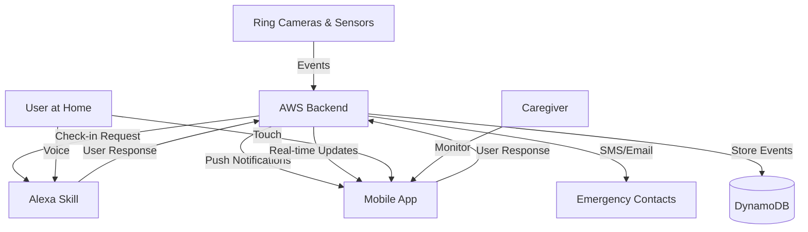
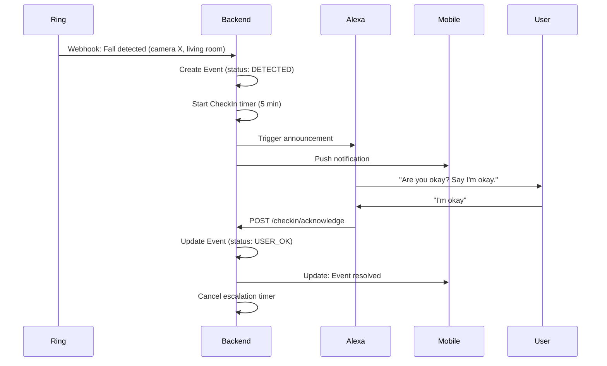
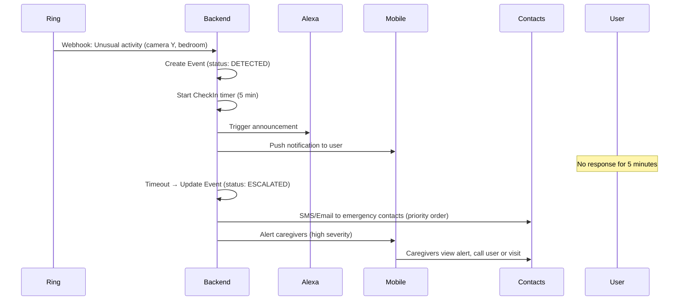
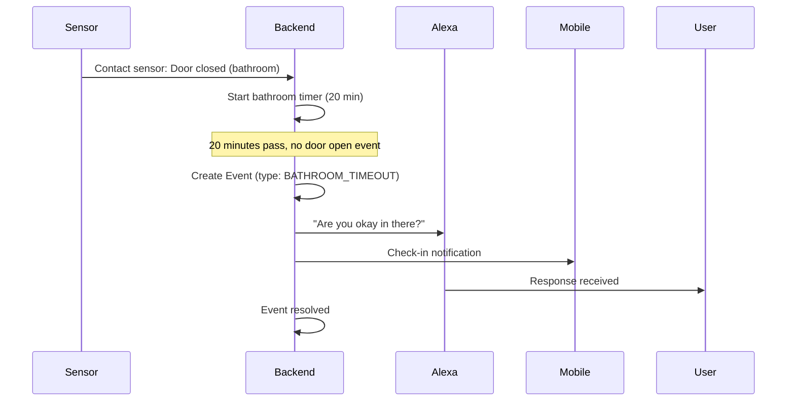

# Still Here - System Architecture

This document describes the technical architecture of the Still Here safety monitoring system.

## System Overview

Still Here is an event-driven safety monitoring system that detects potential emergencies (falls, seizures, inactivity), initiates check-ins with the user, and escalates to caregivers when necessary. The system integrates Ring devices, AWS backend services, Alexa voice interactions, and a mobile app.

## High-Level Components



### 1. Ring Devices & Sandbox

**Purpose**: Detect events and trigger the monitoring pipeline

**Components**:
- Ring cameras (motion, video analytics)
- Ring contact sensors (doors, bathroom)
- Ring motion sensors (rooms, hallways)
- Ring developer sandbox (testing/development)

**Event Types**:
- **Fall Detection**: Sudden motion change + person on floor (video analytics assumption)
- **Seizure/Unusual Activity**: Rapid repeated motion patterns (video analytics assumption)
- **Inactivity**: No motion detected for extended period
- **Bathroom Timeout**: Contact sensor shows entry but no exit within time window

**Integration**:
- Ring REST API webhooks deliver events to AWS API Gateway
- Events include: device ID, timestamp, event type, location, video clip URL (when applicable)

**Open Questions**:
- What video analytics capabilities are available in Ring API?
- Can we access MediaPipe or similar ML models for pose detection?
- What's the webhook authentication mechanism?
- Event payload structure and rate limits?

### 2. AWS Backend

**Purpose**: Central orchestration, event processing, and data storage

**Proposed Services**:

#### API Gateway
- REST API endpoints for mobile app
- Webhook receiver for Ring events
- WebSocket API for real-time updates to mobile clients

#### Lambda Functions
- `ProcessRingEvent`: Receives Ring webhooks, validates, stores event, initiates check-in
- `CheckInHandler`: Manages check-in state machine, timers, escalation logic
- `NotificationDispatcher`: Sends alerts via SNS/SES to caregivers and emergency contacts
- `MobileAPI`: Handles mobile app requests (GET events, POST user responses, settings CRUD)
- `AlexaSkillHandler`: Processes Alexa skill requests and responses

#### DynamoDB Tables
- **Users**: User profiles, medical info, settings, emergency contacts
- **Events**: All detected events with status, responses, outcomes
- **CheckIns**: Active check-in sessions with timers and state
- **Notifications**: Alert history and delivery status

#### SNS (Simple Notification Service)
- Push notifications to mobile apps
- SMS to emergency contacts
- Email alerts

#### SES (Simple Email Service)
- Formatted email alerts with event details

#### CloudWatch
- Event logs
- Monitoring and alerting for system health
- Lambda function metrics

**State Machine**: Check-in Flow
```
DETECTED → CHECKING_IN → (User responds) → USER_OK → RESOLVED
                       ↓
                 (Timeout) → ESCALATED → (Notify contacts) → RESOLVED
```

### 3. Alexa Skill

**Purpose**: Voice-based check-ins and status queries

**Intents**:
- `CheckInIntent`: "Alexa, tell Still Here I'm okay"
- `StatusIntent`: "Alexa, ask Still Here how I'm doing"
- `HelpIntent`: Standard help responses

**Flow**:
1. Backend triggers Alexa notification when event detected
2. Alexa asks: "Are you okay? Say 'I'm okay' if you need help."
3. User responds via voice
4. Skill posts response to backend API
5. Backend updates check-in status

**Open Questions**:
- Can Alexa proactively announce without wake word when event detected?
- Latency between backend trigger and Alexa announcement?
- Multi-device support (which Alexa responds)?

### 4. Mobile App

**Purpose**: User check-ins, caregiver monitoring, EMS information display

**Platforms**: iOS & Android (React Native + Expo)

**User Roles**:
- **Primary User**: Check-in interface, settings, event history
- **Caregiver**: Alert feed, event monitoring, EMS info access

**Screens**:
- **Check-In**: Large "I'm okay" button, timer countdown, event context
- **Caregiver Home**: Alert feed with severity, timestamps, status
- **EMS Info**: Medical data ready for first responders
- **Event Log**: Historical events with details and notes
- **Settings**: Emergency contacts, escalation times, device management

**Real-time Updates**:
- WebSocket connection to backend for live alert delivery
- Push notifications via SNS → Firebase Cloud Messaging (FCM) / APNs

## Data Flow

### Scenario 1: Fall Detection with Successful Check-In



### Scenario 2: Seizure with No Response - Escalation



### Scenario 3: Bathroom Safety Check



## Data Model

### Event Schema
```typescript
{
  id: string;                    // UUID
  userId: string;                // User this event belongs to
  timestamp: ISO8601;            // When event was detected
  type: 'fall' | 'seizure' | 'inactivity' | 'bathroom_timeout';
  duration: number;              // Seconds event lasted (0 for instant)
  location: string;              // Room/device location
  deviceId: string;              // Ring device ID
  videoClipUrl?: string;         // Ring video clip (when applicable)
  status: 'detected' | 'checking_in' | 'user_ok' | 'escalated' | 'resolved';
  userResponse?: 'acknowledged' | 'no_response';
  responseTimestamp?: ISO8601;   // When user responded
  escalatedAt?: ISO8601;         // When escalation began
  resolvedAt?: ISO8601;          // When event closed
  notifiedContacts?: string[];   // Contact IDs notified
  notes?: string;                // Additional context
}
```

### User Settings Schema
```typescript
{
  userId: string;
  escalationTimeLimit: number;        // Seconds before escalating
  bathroomTimeLimit: number;          // Seconds before bathroom check-in
  emergencyContacts: [
    {
      id: string;
      name: string;
      relationship: string;
      phone: string;
      email?: string;
      priority: number;               // 1 = first contacted
    }
  ];
  deviceIds: string[];                // Linked Ring devices
  medicationInfo: {
    currentMedications: string[];
    rescueMedications: string[];
    allergies: string[];
    medicalHistory: string[];
  };
}
```

## Mobile-to-Backend API Endpoints (Draft)

### Authentication
```
POST   /api/auth/login              # User login
POST   /api/auth/logout             # User logout
POST   /api/auth/refresh            # Refresh auth token
```

### User & Settings
```
GET    /api/user/me                      # Get current user profile
PUT    /api/user/me                      # Update profile
GET    /api/user/:id/settings            # Get user settings
PUT    /api/user/:id/settings            # Update settings
GET    /api/user/:id/medication-info     # Get medical info
PUT    /api/user/:id/medication-info     # Update medical info
```

### Events
```
GET    /api/events                       # List events (query: limit, status, type)
GET    /api/events/:id                   # Get event details
POST   /api/events/:id/acknowledge       # User acknowledges check-in
POST   /api/events/:id/note              # Add note to event
```

### Check-Ins
```
GET    /api/checkin/status               # Get active check-in status
POST   /api/checkin/manual               # Manual "I'm okay" check-in
```

### Alerts (Caregiver)
```
GET    /api/user/:id/alerts              # Get alerts for caregiver
POST   /api/alerts/:id/read              # Mark alert as read
```

### Emergency
```
POST   /api/events/:id/notify            # Manually trigger emergency contact notification
POST   /api/events/:id/call-ems          # Request EMS call (user confirmation required)
```

### Devices
```
GET    /api/devices                      # List paired Ring devices
POST   /api/devices/pair                 # Pair new Ring device
DELETE /api/devices/:id                  # Unpair device
```

## Privacy & Security Design

The system adheres to the privacy principles outlined in the main README:

### 1. No Cameras in Private Spaces
- **Implementation**: Device registration validates location type
- Bathroom monitoring uses **contact/motion sensors only**, never cameras
- Settings UI prevents camera assignment to bathroom location

### 2. Caregivers Get Alerts, Not Live Video
- **Implementation**: Mobile app shows event metadata, not video streams
- Video clips (when captured) are stored in Ring cloud, not forwarded to caregivers
- EMS display shows duration/location, not video

### 3. Encrypted Health Data
- **Implementation**: 
  - All data in transit: HTTPS/TLS 1.2+
  - Data at rest: DynamoDB encryption at rest enabled
  - Mobile app: Encrypted storage for cached medical info
  - No PHI in logs or error messages

### 4. Synthetic Test Data Only
- **Implementation**: 
  - Mock data in mobile app for development
  - Ring sandbox for device testing
  - Automated tests use fixtures, not real medical histories
  - `.gitignore` blocks any accidental commits of real user data

### Additional Security Measures
- **Authentication**: OAuth 2.0 / JWT tokens for API access
- **Authorization**: Role-based access control (user vs caregiver)
- **Audit Logging**: All event access and modifications logged
- **Data Retention**: Events auto-expire after 90 days (configurable)
- **Ring Webhook Validation**: HMAC signature verification (assumption)

## Open Questions & Assumptions

### Ring API (Awaiting Developer Documentation)
- [ ] What Ring event types are available via API?
- [ ] Can we access video analytics or ML-based person detection?
- [ ] Webhook authentication mechanism (HMAC, OAuth, API key)?
- [ ] Rate limits for webhook delivery?
- [ ] Can we subscribe to specific device events or must we filter all?
- [ ] Video clip access: direct URL or requires API call?
- [ ] Sensor event payload structure?

### Alexa Integration
- [ ] Can Alexa proactively announce without wake word?
- [ ] How to target specific Echo device in multi-device homes?
- [ ] Latency expectations for announcement delivery?
- [ ] Can we pass event context to Alexa for personalized prompts?

### AWS & Costs
- [ ] Expected Lambda invocation volume and costs?
- [ ] DynamoDB capacity planning for active users?
- [ ] SNS/SES cost per notification?
- [ ] Video storage (if applicable): S3 costs and retention?

### Compliance
- [ ] Is HIPAA compliance required for this use case?
- [ ] Do we need user consent flows for camera/sensor data?
- [ ] Ring Appstore certification requirements for health/safety apps?

## Next Steps

### Sprint 1 (Dec 15 - Dec 28)
- Connect to Ring sandbox and test webhook delivery
- Set up AWS account and initial Lambda + API Gateway
- Implement basic event storage in DynamoDB
- Mobile app: connect API client to real backend (remove mocks)

### Sprint 2 (Dec 29 - Jan 11)
- Complete check-in state machine and timer logic
- Implement SNS push notifications to mobile
- Basic Alexa skill with check-in intent
- End-to-end test: Ring event → backend → Alexa/mobile → response

### Sprint 3 (Jan 12 - Jan 25)
- Bathroom safety timer with sensor-only monitoring
- EMS info display with real medical data
- Event log export for doctor visits
- Caregiver alert feed with real-time updates

### Sprint 4 (Jan 26 - Feb 8)
- UX polish and accessibility testing
- Security review and penetration testing
- Real device testing with Ring Challenge Kit
- Load testing and performance optimization

## References

- [Ring Developer Portal](https://developer.ring.com/) *(access pending)*
- [AWS Lambda Best Practices](https://docs.aws.amazon.com/lambda/latest/dg/best-practices.html)
- [Alexa Skills Kit Documentation](https://developer.amazon.com/en-US/docs/alexa/ask-overviews/what-is-the-alexa-skills-kit.html)
- [React Native Documentation](https://reactnative.dev/)
- [Ring Appstore Program Requirements](https://developer.amazon.com/docs/ring/program-requirements.html)
